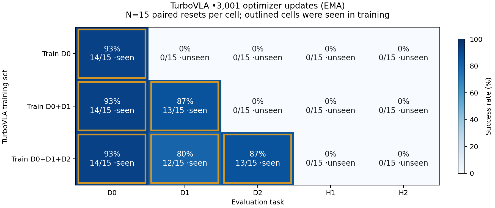

# TurboVLA nested-task results

Three independent 3001-update runs from original DINOv3/BERT/GroundingDINO; final EMA weights.
Reference-protocol evaluation on seeds 10000–10014, 15 episodes per task.
Modified no-noops data: 46/47/48 demos; this differs from pi0’s 50 native demos.
This experiment uses batch 8 and 3001 updates; the paper uses batch 128 and 40k updates.

| Train set | Task | Seen | Successes/N | SR | Wilson 95% CI |
|---|---|---|---|---|---|
| D0 | D0 | True | 14/15 | 93.3% | 70.2%–98.8% |
| D0 | D1 | False | 0/15 | 0.0% | 0.0%–20.4% |
| D0 | D2 | False | 0/15 | 0.0% | 0.0%–20.4% |
| D0 | H1 | False | 0/15 | 0.0% | 0.0%–20.4% |
| D0 | H2 | False | 0/15 | 0.0% | 0.0%–20.4% |
| D0+D1 | D0 | True | 14/15 | 93.3% | 70.2%–98.8% |
| D0+D1 | D1 | True | 13/15 | 86.7% | 62.1%–96.3% |
| D0+D1 | D2 | False | 0/15 | 0.0% | 0.0%–20.4% |
| D0+D1 | H1 | False | 0/15 | 0.0% | 0.0%–20.4% |
| D0+D1 | H2 | False | 0/15 | 0.0% | 0.0%–20.4% |
| D0+D1+D2 | D0 | True | 14/15 | 93.3% | 70.2%–98.8% |
| D0+D1+D2 | D1 | True | 12/15 | 80.0% | 54.8%–93.0% |
| D0+D1+D2 | D2 | True | 13/15 | 86.7% | 62.1%–96.3% |
| D0+D1+D2 | H1 | False | 0/15 | 0.0% | 0.0%–20.4% |
| D0+D1+D2 | H2 | False | 0/15 | 0.0% | 0.0%–20.4% |

H1/H2 never enter training or normalization. All seeds are shared across models.
